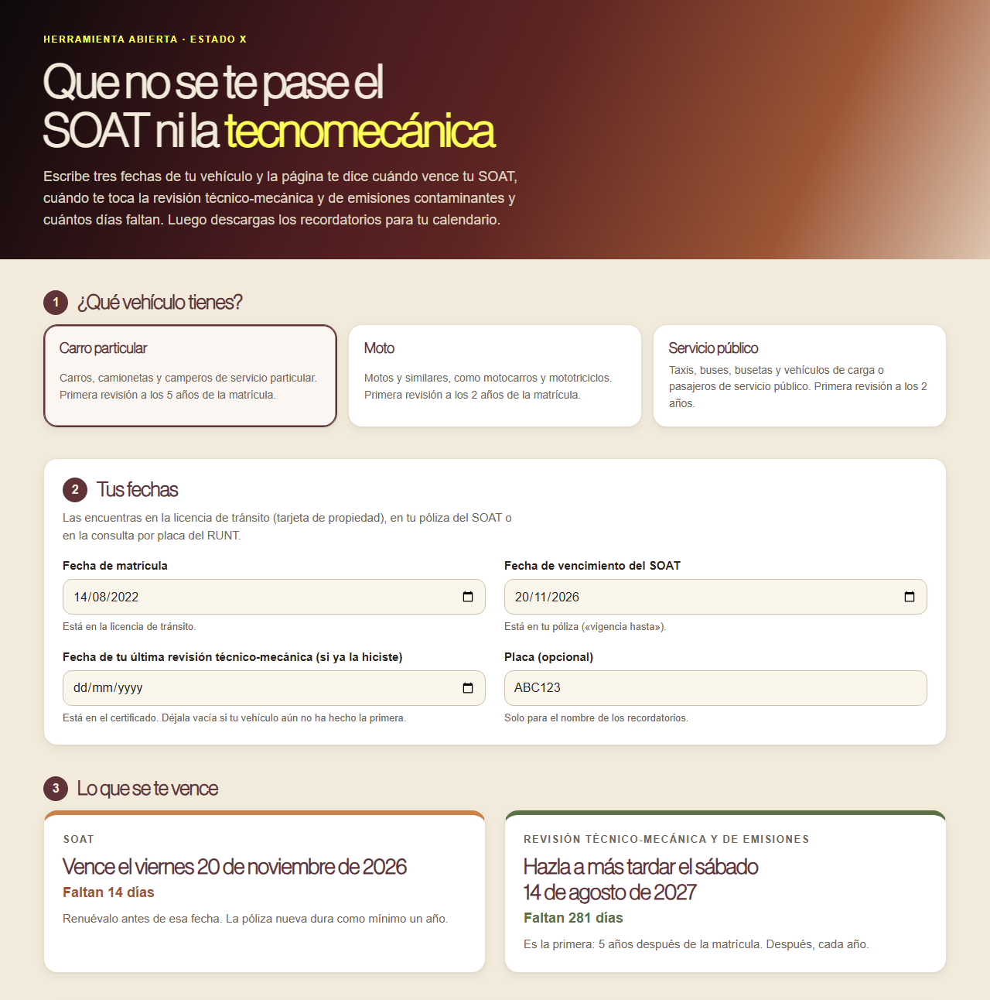

# Que no se te pase el SOAT ni la tecnomecánica

**[Español](#español) · [English](#english)**

## Español

Herramienta abierta para **saber cuándo vence el SOAT de tu vehículo y cuándo te toca la revisión técnico-mecánica y de emisiones contaminantes**, cuántos días faltan, y descargar los recordatorios para tu calendario.

**Ábrela aquí:** https://estado-x.github.io/carro-al-dia-colombia/

### Qué hace

Escoges el tipo de vehículo y escribes la fecha de matrícula, la de vencimiento del SOAT y, si ya la hiciste, la de tu última revisión. La página calcula:

| Vehículo | Primera revisión técnico-mecánica | Después | Norma |
|---|---|---|---|
| Carro particular (no motos) | A los 5 años de la matrícula. Matriculados entre el 20/05/2017 y el 19/05/2018: a los 6 años | Cada año | Ley 769 de 2002, arts. 51 y 52 (modificado por la Ley 2294 de 2023, art. 179); Circular Externa del Ministerio de Transporte del 19/10/2023 |
| Moto y similares | A los 2 años de la matrícula | Cada año | Ley 769 de 2002, arts. 51 y 52 |
| Servicio público | A los 2 años de la matrícula | Cada año | Ley 769 de 2002, arts. 51 y 52 |

Además:

- **SOAT:** la fecha en que vence y cuántos días faltan, con aviso si está por vencer (30 días o menos) o vencido. La póliza dura cuando menos un año (Decreto 663 de 1993, art. 193, num. 2).
- **Calendario (.ics):** un archivo para Google Calendar, Outlook o el calendario del celular, con cada vencimiento y un aviso aparte en los días que escojas antes (60, 30, 15, 7 o 1), cada uno con alarma a las 9:00 a. m. del día anterior. Se arma en tu navegador.
- **Fuentes oficiales:** enlaces a la consulta por placa del [RUNT](https://portalpublico.runt.gov.co/#/consulta-vehiculo/consulta/consulta-ciudadana) y al estado de cuenta del [SIMIT](https://www.fcm.org.co/simit/#/estado-cuenta). La página no los consulta: entras tú.

### Cómo funciona

- Es una página estática (HTML, CSS y JavaScript) publicada con GitHub Pages. No tiene servidor ni base de datos, no necesita claves, **no envía a ningún lado** lo que escribes y no guarda nada: al cerrar la página, se borra.
- `assets/fechas.js` tiene las reglas y los cálculos (años de calendario, días que faltan, el archivo .ics); `assets/app.js` es la interfaz. Las pruebas, en `pruebas/`, revisan casos de control: la excepción de 2017-2018, una matrícula del 29 de febrero, fines de mes y el formato del calendario.
- Los años se cuentan de fecha a fecha. Si el día no existe en el año de llegada (29 de febrero), se toma el 28 de febrero, para que el aviso llegue antes y no después.

### Úsala o adáptala

1. Haz un fork de este repositorio.
2. Activa GitHub Pages (Settings → Pages → rama `main`, carpeta raíz).
3. Para probarla en tu computador: `python -m http.server` y abre `http://localhost:8000`. Para correr las pruebas: `node --test pruebas/` (Node 18 o superior, sin instalar nada).

Si cambia la regla, los años están en `TIPOS` y la excepción en `EXC_DESDE` y `EXC_HASTA`, en `assets/fechas.js`.

### Límites

- Es una ayuda para no olvidar fechas, **no un certificado**. Lo que vale es lo que diga el RUNT.
- No consulta el RUNT ni el SIMIT (piden una verificación), no guarda tus fechas y no manda avisos: los avisos los da tu calendario.
- No cubre el impuesto vehicular: cada departamento (y Bogotá) fija sus fechas.
- No cubre multas ni comparendos: para eso está el SIMIT.
- Cubre carros particulares, motos y vehículos de servicio público matriculados como nuevos. No cubre placas extranjeras, vehículos oficiales o diplomáticos, ni casos especiales como la exención del certificado de emisiones de los vehículos nuevos a gas (Ley 2128 de 2021, art. 18).
- La regla de los 5 años para carros particulares viene del Plan Nacional de Desarrollo 2022-2026 (Ley 2294 de 2023). Si cambia, hay que actualizar `assets/fechas.js`.

### Crédito

- Inspirada en [LubeLogger](https://github.com/hargata/lubelog) de Hargata Softworks (licencia MIT), un programa con servidor para llevar el mantenimiento de vehículos. No reutiliza su código.
- Normas: Ley 769 de 2002 (Código Nacional de Tránsito), arts. 51, 52 y 131; Ley 2294 de 2023, art. 179; Decreto 663 de 1993, art. 193. Texto consultado en la Secretaría del Senado. Circular Externa del Ministerio de Transporte del 19 de octubre de 2023, citada en sus conceptos jurídicos.

### Hecho por Estado X

[Estado X](https://estadox.com) · Licencia MIT.

---

## English

An open tool to **know when your vehicle's mandatory insurance (SOAT) expires and when its technical-mechanical and emissions inspection is due in Colombia**, with the days left and calendar reminders.

**Open it here:** https://estado-x.github.io/carro-al-dia-colombia/

### What it does

Pick the vehicle type (private car, motorcycle or public-service vehicle) and enter the registration date, the SOAT expiry date and, if any, your last inspection date. It computes the first inspection (5 years after registration for private cars, 2 years for motorcycles and public-service vehicles, per Law 769 of 2002, art. 52, as amended by Law 2294 of 2023, including the Ministry of Transport's 2017–2018 exception), the yearly inspection after that, and the SOAT deadline. It builds a calendar file (.ics) with reminders and links to the official RUNT and SIMIT lookups.

### How it works

A static page on GitHub Pages: no server, no database, no keys, and **nothing you type leaves your browser** or is stored. Tests: `node --test pruebas/`.

### Limits

A reminder aid, **not an official record**: the RUNT is the source of truth. It does not query official databases, and it does not cover vehicle tax (set by each department) or traffic fines.

### Credits

Inspired by [LubeLogger](https://github.com/hargata/lubelog) by Hargata Softworks (MIT), a self-hosted vehicle maintenance tracker; no code reused.

### Made by Estado X

[Estado X](https://estadox.com) · MIT License.
